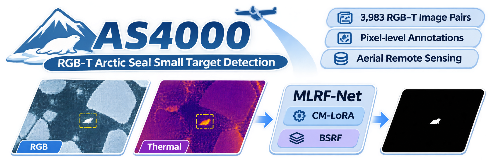
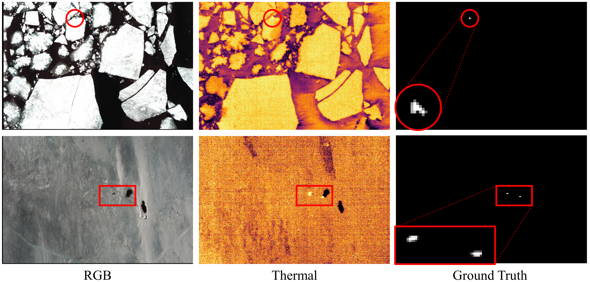
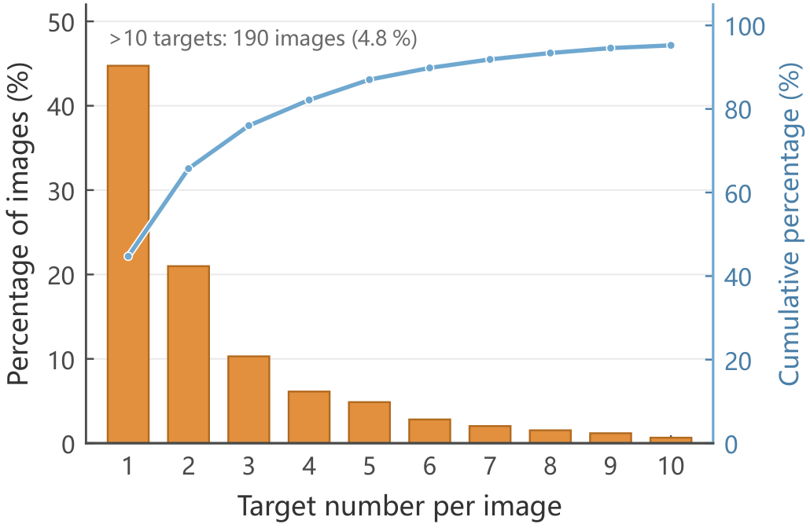
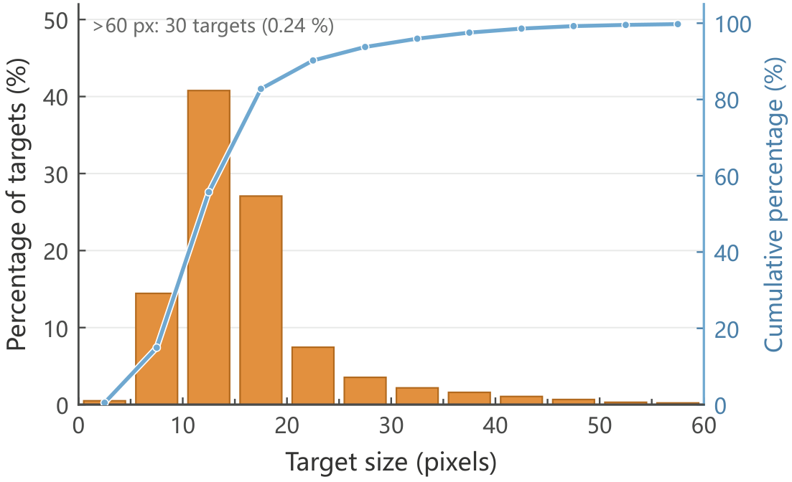
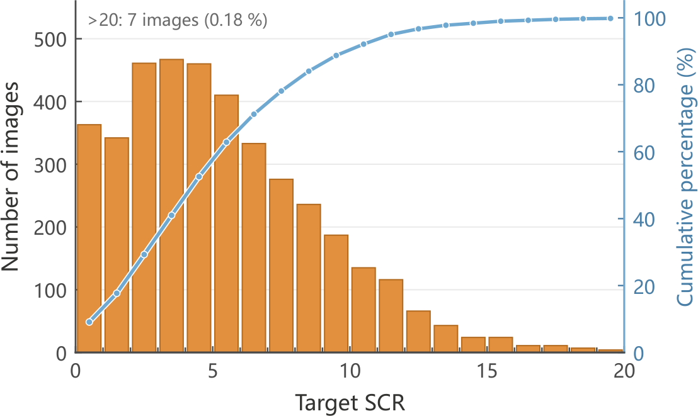
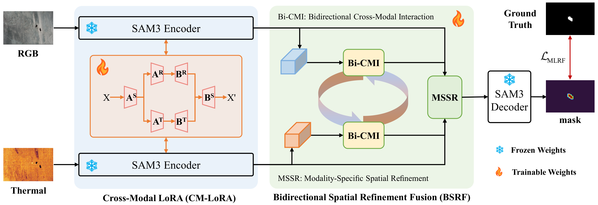
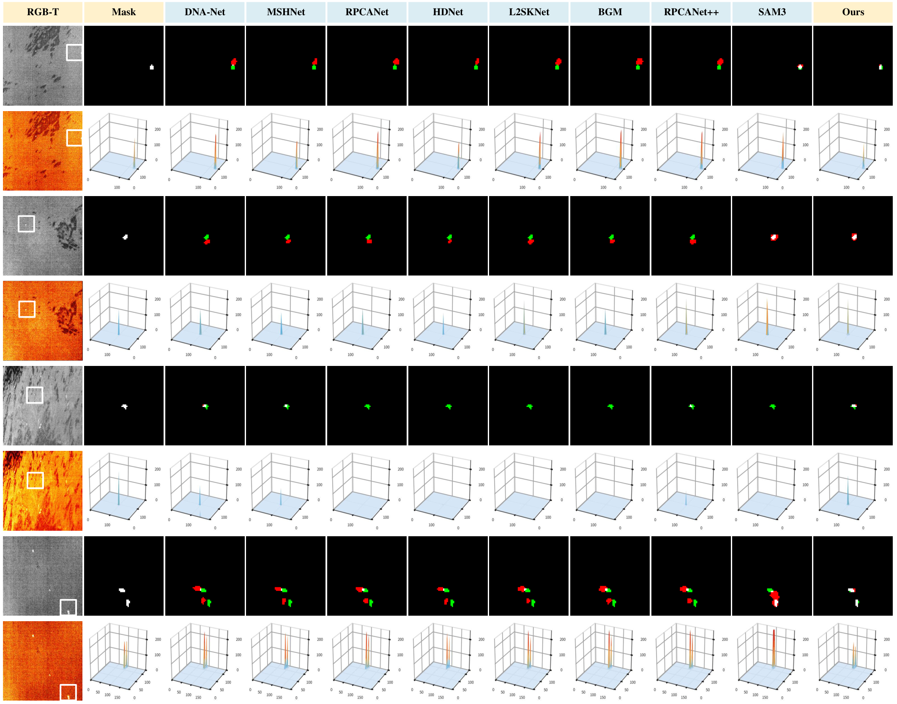

<h1 align="justify">AS4000: A Benchmark for RGB-Thermal Arctic Seal Small Target Detection via Multimodal Low-Rank Adaptation Fusion</h1>

<p align="center">
  
  
  
  
  
</p>



<p align="center"><strong>🖼️ 3,983</strong> paired RGB-T images · <strong>🦭 12,554</strong> seals · <strong>📐 mostly 10–20</strong> pixels · <strong>🏷️ pixel-level masks</strong></p>

<p align="justify">This repository is the <strong>1st</strong> work focused on RGB-T Small Target Detection of Arctic seals. For this task, we release AS4000, the <strong>1st</strong> multimodal benchmark for detecting extremely small Arctic seals in RGB–thermal imagery. These remote sensing observations are important for monitoring polar wildlife and for ecological assessment of seal populations in a changing sea-ice environment.</p>


## ✨ Highlights

<table align="center">
  <tr><td align="center">🖼️ Pairs</td><td align="center">3,983 spatially aligned RGB–thermal images</td></tr>
  <tr><td align="center">🦭 Targets</td><td align="center">12,554 seals, 3.15 per image</td></tr>
  <tr><td align="center">🏷️ Labels</td><td align="center">Pixel masks and bounding boxes</td></tr>
  <tr><td align="center">📐 Target size</td><td align="center">Most seals cover about 10–20 pixels</td></tr>
  <tr><td align="center">✂️ Split</td><td align="center">1,500 train / 500 val / 1,983 test</td></tr>
</table>

## 🗂️ Dataset

<p align="justify">To support RGB-Thermal small target detection research in polar environments, we establish AS4000. AS4000 comprises 3,983 paired RGB and thermal images with pixel-level target annotations, focusing on extremely small Arctic seals against heterogeneous ice and water backgrounds. Unlike conventional RGB-T benchmarks dominated by generic objects, AS4000 provides a task-specific dataset for investigating sparse wildlife targets, complex background interference, and complementary modality responses.</p>

<p align="center">
  
</p>

<p align="justify">The 3,983 paired images are divided into 1,500 training pairs, 500 validation pairs, and 1,983 testing pairs. Approximately 45% of the images contain a single target, and the frequency decreases as the target count increases, indicating a predominantly sparse target distribution. Most targets are concentrated around 10~20 pixels. Furthermore, most targets exhibit relatively low to moderate contrast against surrounding clutter. These statistical characteristics demonstrate the challenges of detecting sparse, extremely small targets under heterogeneous Arctic background conditions.</p>

<p align="center">  </p>

<p align="justify">The training, validation, and test splits use the same layout. Each sample keeps one file stem in all four folders. <code>RGB</code> stores the visible image, <code>T</code> the thermal image, <code>box</code> the pixel <code>xyxy</code> boxes with one box per line, and <code>GT</code> the mask, where pixels above 128 are foreground. Thermal TIFF values must keep the normalization in <code>data.py</code>, so the frozen thermal LoRA sees the distribution it was trained on.</p>

<div align="center">

| Split | Images | Targets | Per image | Download |
| :---: | :---: | :---: | :---: | :---: |
| Train | 1,500 | 4,300 | 2.87 | [Baidu Netdisk](https://pan.baidu.com/s/1jybcryZ1uE8vph3uX5hVKw?pwd=Seal) |
| Validation | 500 | 871 | 1.74 | [Email](mailto:1546144577@qq.com) |
| Test | 1,983 | 7,383 | 3.72 | [Email](mailto:1546144577@qq.com) |
| **Total** | **3,983** | **12,554** | **3.15** | |

</div>

```text
train/   val/   test/
├── RGB/*.jpg
├── T/*.tif
├── box/*.txt
└── GT/*.png
```

<p align="justify">The recommended directory layout for the dataset is as follows.</p>

```text
data/train/RGB/*.jpg
data/train/T/*.tif
data/train/box/*.txt
data/train/GT/*.png
data/val/...
data/test/...
```

## 🧠 Baseline: MLRF-Net

<p align="justify">This repository also releases a baseline for this benchmark. MLRF-Net targets the same setting: tiny seals, cluttered ice, and RGB–thermal responses that do not match. It combines Cross-Modal Low-Rank Adaptation (CM-LoRA) and Bidirectional Spatial Refinement Fusion (BSRF).</p>

<p align="justify">CM-LoRA freezes the pretrained <a href="https://github.com/Sompote/SAM3_LoRA">SAM3</a> encoders and adapts them with a modality-specific adapter on each branch plus one shared low-rank update, so RGB and thermal features are tuned together while the pretrained weights stay intact.</p>

<p align="justify">BSRF exchanges the two feature maps with bidirectional cross-attention and then refines each modality spatially. The fused representation uses complementary cues and makes the small targets easier to localize.</p>



### Quantitative

<div align="justify">

On AS4000, MLRF-Net reaches 51.93% IoU, 68.36% F1, 89.15% detection probability, and a false-alarm rate of 17.17×10<sup>-6</sup>, ahead of the compared methods on all four accuracy metrics. The best result in each column is shown in $\color{red}{\pmb{\mathrm{bold\ red}}}$, and the second-best result in $\color{blue}{\mathrm{blue}}$.

</div>

<div align="center">

| Methods | Pub. | Params ↓ | GFLOPs ↓ | FPS ↑ | IoU ↑ | F<sub>1</sub> ↑ | P<sub>d</sub> ↑ | F<sub>a</sub> ↓ |
| :---: | :---: | :---: | :---: | :---: | :---: | :---: | :---: | :---: |
| [DNA-Net](https://github.com/YeRen123455/Infrared-Small-Target-Detection) | TIP, 2023 | 4.70 | 14.28 | 64.20 | 30.00 | 46.15 | 79.05 | 87.30 |
| [UIU-Net](https://github.com/danfenghong/IEEE_TIP_UIU-Net) | TIP, 2023 | 50.54 | 54.50 | 118.40 | 21.49 | 35.37 | 68.74 | 29.65 |
| [MSHNet](https://github.com/Lliu666/MSHNet) | CVPR, 2024 | 4.07 | $\color{blue}{6.11}$ | 152.30 | 29.23 | 45.23 | 80.94 | 67.28 |
| [RPCANet](https://github.com/fengyiwu98/RPCANet) | WACV, 2024 | $\color{red}{\pmb{0.68}}$ | 44.57 | 211.30 | 30.64 | 46.91 | 80.62 | 77.57 |
| [SCTransNet](https://github.com/xdFai/SCTransNet) | TGRS, 2024 | 11.33 | 10.12 | 109.20 | 20.29 | 33.74 | 62.21 | 25.28 |
| [HDNet](https://github.com/xumingzhu989/HDNet-TGRS) | TGRS, 2025 | 3.68 | $\color{red}{\pmb{5.70}}$ | 85.50 | 27.26 | 42.84 | $\color{blue}{82.14}$ | 54.50 |
| [BGM](https://github.com/ZhihaoMa123/BGM) | TGRS, 2025 | 4.08 | 6.77 | $\color{blue}{212.10}$ | $\color{blue}{30.74}$ | $\color{blue}{47.02}$ | 78.68 | 96.32 |
| [ILNet](https://github.com/Li-Haoqing/ILNet) | TAES, 2025 | 4.04 | 21.42 | 108.40 | 19.17 | 32.18 | 58.95 | $\color{blue}{19.30}$ |
| [DRPCA-Net](https://github.com/GrokCV/DRPCA-Net) | TGRS, 2025 | 1.17 | 73.84 | 11.20 | 29.99 | 46.14 | 76.85 | 104.04 |
| [L2SKNet](https://github.com/fengyiwu98/L2SKNet) | TGRS, 2025 | $\color{blue}{0.90}$ | 6.90 | $\color{red}{\pmb{332.20}}$ | 30.09 | 46.26 | 77.20 | 86.24 |
| [RPCANet++](https://github.com/fengyiwu98/RPCANet) | TPAMI, 2026 | 2.96 | 190.67 | 80.40 | 30.10 | 46.27 | 76.92 | 88.16 |
| [DURD](https://github.com/haofan72/DURD) | TGRS, 2026 | 2.47 | 52.85 | 125.30 | 30.06 | 46.23 | 77.58 | 102.84 |
| [SAM3](https://github.com/facebookresearch/sam3) | ICLR, 2026 | 473.59 | 7149.94 | 3.30 | 22.47 | 36.70 | 68.79 | 350.80 |
| **MLRF-Net** | -- | 9.09 | 110.11 | 13.61 | $\color{red}{\pmb{51.93}}$ | $\color{red}{\pmb{68.36}}$ | $\color{red}{\pmb{89.15}}$ | $\color{red}{\pmb{17.17}}$ |

</div>

### Qualitative

<p align="justify">The qualitative visualization of MLRF-Net and the compared methods clearly shows the advantage of MLRF-Net.</p>



## 🛠️ Setup

<p align="justify">Linux, an NVIDIA GPU, Python 3.12, and PyTorch 2.7 or newer.</p>

```bash
pip install -r requirements.txt
```

<p align="justify"><code>third_party/sam3</code> is the SAM 3 package imported by this repository. It comes from <a href="https://github.com/Sompote/SAM3_LoRA">SAM3-LoRA</a>. The SAM 3 code is SAM material from Meta and remains under the license in <code>third_party/sam3/LICENSE</code>.</p>

## 📦 Download

<p align="justify">Three pretrained weights, one best trained model, and the prediction results are on Baidu Netdisk.</p>

<div align="center">

| Content | Description | Link |
| :---: | :---: | :---: |
| `sam3.pt` | Frozen SAM3 checkpoint for training and testing. | [Baidu Netdisk](https://pan.baidu.com/s/1JwaF6WmSvZWhKpDP5FQzIQ?pwd=SAM3) |
| `rgb_lora.pt` | Frozen LoRA weights for the RGB branch. | [Baidu Netdisk](https://pan.baidu.com/s/1bXAps5I6cxG5c9McIgVq6A?pwd=LoRA) |
| `thermal_lora.pt` | Frozen LoRA weights for the thermal branch. | [Baidu Netdisk](https://pan.baidu.com/s/18khwgIBfMxJAAub6xG7Fmw?pwd=LoRA) |
| `best.pth` | Trained BSRF and CM-LoRA weights for testing. | [Baidu Netdisk](https://pan.baidu.com/s/1Jft2i6gBvHjPJtzwamEaYw?pwd=best) |
| Prediction results | Precomputed test probability maps for evaluation. | [Baidu Netdisk](https://pan.baidu.com/s/12qjWecExrdNCf_wFrBwfZA?pwd=pred) |

</div>

<p align="justify">The recommended directory layout for the weights is as follows. If it differs, specify the paths through command-line arguments when running.</p>

```text
weights/sam3.pt
weights/rgb_lora.pt
weights/thermal_lora.pt
weights/best.pth
```

## 🚀 Train

<p align="justify">Use the first command to train on one GPU, and the second to train on multiple GPUs.</p>

```bash
python train.py \
  --checkpoint weights/sam3.pt \
  --rgb_lora weights/rgb_lora.pt \
  --thermal_lora weights/thermal_lora.pt \
  --train_data_dir data/train \
  --val_data_dir data/val \
  --save_path train_logs

torchrun --nproc_per_node=4 train.py \
  --checkpoint weights/sam3.pt \
  --rgb_lora weights/rgb_lora.pt \
  --thermal_lora weights/thermal_lora.pt \
  --train_data_dir data/train \
  --val_data_dir data/val \
  --save_path train_logs
```

## 🔎 Test

<p align="justify">Use the following command to test.</p>

```bash
python test.py \
  --checkpoint weights/best.pth \
  --sam_checkpoint weights/sam3.pt \
  --rgb_lora weights/rgb_lora.pt \
  --thermal_lora weights/thermal_lora.pt \
  --test_data_dir data/test \
  --save_dir test_maps
```

## 📊 Evaluate

<p align="justify">Use the following command to evaluate.</p>

```bash
python evaluate.py \
  --pred_root test_maps \
  --gt_dir data/test/GT
```

<!--
## 📝 Citation

```bibtex
% Paste the BibTeX entry of this paper here.
```

## 📚 References

```bibtex
@inproceedings{carion2026sam,
  title={Sam 3: Segment anything with concepts},
  author={Carion, Nicolas and Gustafson, Laura and Hu, Yuan-Ting and Debnath, Shoubhik and Hu, Ronghang and Suris Coll-Vinent, Didac and Ryali, Chaitanya and Alwala, Kalyan Vasudev and Khedr, Haitham and Huang, Andrew and others},
  booktitle={International conference on learning representations},
  volume={2026},
  pages={138846--138923},
  year={2026}
}

@software{sam3_lora,
  title = {SAM3-LoRA: Low-Rank Adaptation for Fine-Tuning},
  author = {AI Research Group, KMUTT},
  year = {2026},
  version = {0.3.0},
  organization = {King Mongkut's University of Technology Thonburi},
  url = {https://github.com/Sompote/SAM3_LoRA}
}
```

## ⭐ Star History

[](https://www.star-history.com/#VisionVerse/AS4000&Date)
-->

## 📬 Contact

<p align="justify">For the validation set, the test set, or other questions, email <a href="mailto:1546144577@qq.com">1546144577@qq.com</a>.</p>
