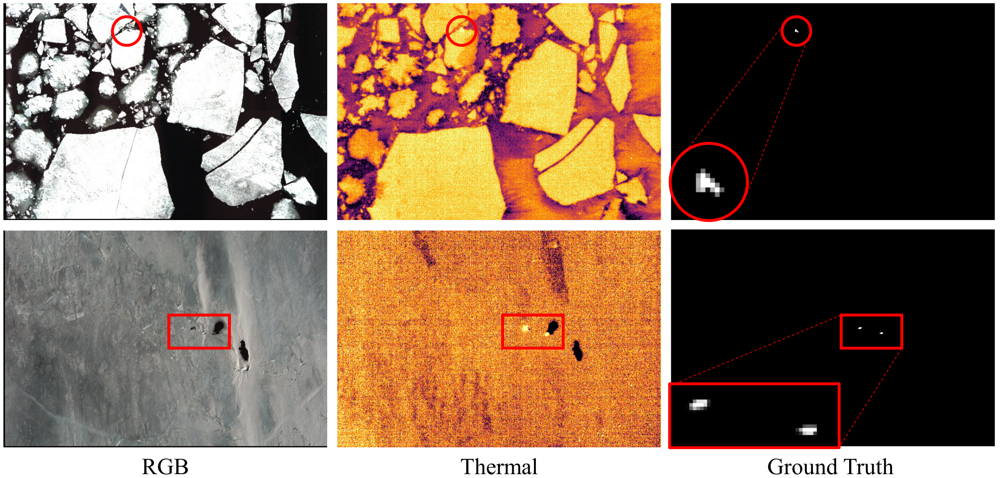
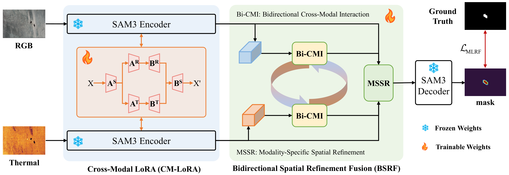

# AS4000：北极海豹 RGB–热红外小目标检测基准

[English](README.md)

[](https://github.com/VisionVerse/AS4000/stargazers)

**🖼️ 3983** 对航空图像 · **🦭 12554** 只海豹 · **📐 大多只有 10–20** 像素 · **🏷️ 像素级标注**

AS4000 是面向航空 RGB–热红外图像中极小北极海豹的检测基准。数据集是这个仓库的主体，MLRF-Net 是随基准一起给出的基线方法。

<p align="center">
  
</p>

<p align="center">
  RGB 记录冰面纹理，热红外给出另一套辐射分布。海豹往往只有几个像素宽。
</p>

## ✨ 数据一览

| | |
| --- | --- |
| 🖼️ 图像对 | 3983 对空间对齐的 RGB–热红外图像 |
| 🦭 目标 | 12554 只，平均每张 3.15 只 |
| 🏷️ 标注 | 像素级掩膜和包围框 |
| 📐 目标尺寸 | 大多数约 10–20 像素 |
| ✂️ 划分 | 训练 1500 / 验证 500 / 测试 1983 |

## 🗂️ 数据集

AS4000 用于极地环境下的 RGB–热红外小目标检测。常规 RGB–T 基准以通用物体为主。AS4000 关注的是稀疏的野生动物、破碎的冰面和水面，以及两种并不一致的模态响应。

RGB 记录表面纹理、冰面结构和海豹的可见外观，包括破碎海冰、不规则冰缘和细碎的表面纹理。热红外记录辐射，背景强度和空间模式与 RGB 差异很大。两种信号互补，但并不对应。海豹可能看起来像一块冰，也可能只是局部热异常。

| 划分 | 图像 | 目标 | 每张 |
| --- | ---: | ---: | ---: |
| 训练 | 1500 | 4300 | 2.87 |
| 验证 | 500 | 871 | 1.74 |
| 测试 | 1983 | 7383 | 3.72 |
| **合计** | **3983** | **12554** | **3.15** |

信杂比分布较宽，多数目标相对周围杂波只有偏低到中等的对比度。

每个样本在四个文件夹中使用同一个文件主名：

```text
RGB/*.jpg    T/*.tif    box/*.txt    GT/*.png
```

框是像素 `xyxy`，一行一个框。掩膜中大于 128 的像素为前景。热红外 TIFF 必须保持 `data.py` 中的归一化顺序，冻结的热红外 LoRA 才能看到原来的输入分布。

## 🧠 基线方法：MLRF-Net

仓库同时给出这个基准上的一个基线。MLRF-Net 针对的就是很小的海豹、复杂冰面，以及不一致的 RGB–热红外响应。它由跨模态低秩适配（CM-LoRA）和双向空间细化融合（BSRF）组成。

CM-LoRA 冻结预训练的 [SAM3](https://github.com/Sompote/SAM3_LoRA) 编码器，在 RGB 和热红外分支上分别使用模态适配器，再用一组共享低秩参数协同更新两路特征，从而在保留预训练知识的同时完成轻量适配。

BSRF 先用双向交叉注意力交换两路特征，再分别做空间细化。融合后的表示吸收互补信息，便于在复杂背景中定位小目标。



在 AS4000 上，MLRF-Net 的 IoU 为 51.93%，F<sub>1</sub> 为 68.36%，检测概率为 89.15%，虚警率为 17.17×10<sup>-6</sup>，四项精度指标均高于所比较的方法。

AS4000 上与现有方法的效率和精度对比。F<sub>a</sub> 的单位为 10<sup>-6</sup>。↑ 表示越大越好，↓ 表示越小越好。每列最优结果为红色加粗，例如 $\color{red}{\pmb{51.93}}$；次优结果为蓝色，例如 $\color{blue}{30.74}$。

| 方法 | 发表 | Params ↓ | GFLOPs ↓ | FPS ↑ | IoU ↑ | F<sub>1</sub> ↑ | P<sub>d</sub> ↑ | F<sub>a</sub> ↓ |
| --- | --- | ---: | ---: | ---: | ---: | ---: | ---: | ---: |
| DNA-Net | TIP, 2023 | 4.70 | 14.28 | 64.20 | 30.00 | 46.15 | 79.05 | 87.30 |
| UIU-Net | TIP, 2023 | 50.54 | 54.50 | 118.40 | 21.49 | 35.37 | 68.74 | 29.65 |
| MSHNet | CVPR, 2024 | 4.07 | $\color{blue}{6.11}$ | 152.30 | 29.23 | 45.23 | 80.94 | 67.28 |
| RPCANet | WACV, 2024 | $\color{red}{\pmb{0.68}}$ | 44.57 | 211.30 | 30.64 | 46.91 | 80.62 | 77.57 |
| SCTransNet | TGRS, 2024 | 11.33 | 10.12 | 109.20 | 20.29 | 33.74 | 62.21 | 25.28 |
| HDNet | TGRS, 2025 | 3.68 | $\color{red}{\pmb{5.70}}$ | 85.50 | 27.26 | 42.84 | $\color{blue}{82.14}$ | 54.50 |
| BGM | TGRS, 2025 | 4.08 | 6.77 | $\color{blue}{212.10}$ | $\color{blue}{30.74}$ | $\color{blue}{47.02}$ | 78.68 | 96.32 |
| ILNet | TAES, 2025 | 4.04 | 21.42 | 108.40 | 19.17 | 32.18 | 58.95 | $\color{blue}{19.30}$ |
| DRPCA-Net | TGRS, 2025 | 1.17 | 73.84 | 11.20 | 29.99 | 46.14 | 76.85 | 104.04 |
| L2SKNet | TGRS, 2025 | $\color{blue}{0.90}$ | 6.90 | $\color{red}{\pmb{332.20}}$ | 30.09 | 46.26 | 77.20 | 86.24 |
| RPCANet++ | TPAMI, 2026 | 2.96 | 190.67 | 80.40 | 30.10 | 46.27 | 76.92 | 88.16 |
| DURD | TGRS, 2026 | 2.47 | 52.85 | 125.30 | 30.06 | 46.23 | 77.58 | 102.84 |
| SAM3 | ICLR, 2026 | 473.59 | 7149.94 | 3.30 | 22.47 | 36.70 | 68.79 | 350.80 |
| **本文** | -- | 9.09 | 110.11 | 13.61 | $\color{red}{\pmb{51.93}}$ | $\color{red}{\pmb{68.36}}$ | $\color{red}{\pmb{89.15}}$ | $\color{red}{\pmb{17.17}}$ |

## 🛠️ 环境

在带 NVIDIA GPU 的 Linux 机器上运行，Python 3.12，PyTorch 2.7 或更高版本。

```bash
pip install -r requirements.txt
```

`third_party/sam3` 是本仓库实际导入的 SAM 3 代码，来自 [SAM3-LoRA](https://github.com/Sompote/SAM3_LoRA)。其中的 SAM 3 代码属于 Meta 的 SAM 材料，许可见 `third_party/sam3/LICENSE`。

## 📦 下载

训练集和 4 个权重文件放在百度网盘。验证集或测试集请联系 [1546144577@qq.com](mailto:1546144577@qq.com)。

| 内容 | 链接 |
| --- | --- |
| 训练集 | [【百度网盘】](https://pan.baidu.com/s/1jybcryZ1uE8vph3uX5hVKw?pwd=Seal) |
| 验证集 | [【邮箱】](mailto:1546144577@qq.com) |
| 测试集 | [【邮箱】](mailto:1546144577@qq.com) |
| `sam3.pt` | [【百度网盘】](https://pan.baidu.com/s/1JwaF6WmSvZWhKpDP5FQzIQ?pwd=SAM3) |
| `rgb_lora.pt` | [【百度网盘】](https://pan.baidu.com/s/1bXAps5I6cxG5c9McIgVq6A?pwd=LoRA) |
| `thermal_lora.pt` | [【百度网盘】](https://pan.baidu.com/s/18khwgIBfMxJAAub6xG7Fmw?pwd=LoRA) |
| `best.pth` | [【百度网盘】](https://pan.baidu.com/s/1Jft2i6gBvHjPJtzwamEaYw?pwd=best) |
| 预测结果 | [【百度网盘】](https://pan.baidu.com/s/12qjWecExrdNCf_wFrBwfZA?pwd=pred) |

下载后按下面的结构放置。如果压缩包里的文件名不同，修改 `paths.py` 里的路径，或在命令行传入对应参数。

```text
data/train/RGB/*.jpg
data/train/T/*.tif
data/train/box/*.txt
data/train/GT/*.png
data/val/...
data/test/...

weights/sam3.pt
weights/rgb_lora.pt
weights/thermal_lora.pt
weights/best.pth
```

`sam3.pt` 是 SAM3 图像模型权重。`rgb_lora.pt` 和 `thermal_lora.pt` 是冻结的模态 LoRA。`best.pth` 保存训练好的 BSRF 和 CM-LoRA。

## 🚀 训练

```bash
python train.py \
  --checkpoint weights/sam3.pt \
  --rgb_lora weights/rgb_lora.pt \
  --thermal_lora weights/thermal_lora.pt \
  --train_data_dir data/train \
  --val_data_dir data/val

torchrun --nproc_per_node=4 train.py \
  --checkpoint weights/sam3.pt \
  --rgb_lora weights/rgb_lora.pt \
  --thermal_lora weights/thermal_lora.pt \
  --train_data_dir data/train \
  --val_data_dir data/val
```

每张 GPU 每次处理 1 张图像。多卡时，BSRF 和 CM-LoRA 的梯度在卡间取平均。默认训练 30 个 epoch。验证集上最好的权重保存到 `train_logs/best.pth`。

## 🔎 测试

```bash
python test.py \
  --checkpoint weights/best.pth \
  --sam_checkpoint weights/sam3.pt \
  --rgb_lora weights/rgb_lora.pt \
  --thermal_lora weights/thermal_lora.pt \
  --test_data_dir data/test
```

每张测试图像输出一张 8 位概率图，保存在 `test_maps/`，分辨率为原始图像尺寸。

## 📊 评估

```bash
python evaluate.py --pred_root test_maps
```

输出 S、加权 F、E、MAE、IoU、F1、Pd 和 Fa。IoU 与 F1 在概率大于 0.5 处二值化。Pd 和 Fa 使用 8 连通域，质心距离小于 3 像素视为匹配。Fa 是未匹配预测连通域的面积除以图像总像素数。

## 📝 引用

```bibtex
% 在这里粘贴本论文的 BibTeX。
```

## 📚 参考文献

```bibtex
@inproceedings{carion2026sam,
  title={Sam 3: Segment anything with concepts},
  author={Carion, Nicolas and Gustafson, Laura and Hu, Yuan-Ting and Debnath, Shoubhik and Hu, Ronghang and Suris Coll-Vinent, Didac and Ryali, Chaitanya and Alwala, Kalyan Vasudev and Khedr, Haitham and Huang, Andrew and others},
  booktitle={International conference on learning representations},
  volume={2026},
  pages={138846--138923},
  year={2026}
}

@software{sam3_lora,
  title = {SAM3-LoRA: Low-Rank Adaptation for Fine-Tuning},
  author = {AI Research Group, KMUTT},
  year = {2026},
  version = {0.3.0},
  organization = {King Mongkut's University of Technology Thonburi},
  url = {https://github.com/Sompote/SAM3_LoRA}
}
```

## ⭐ Star 数量变化

[](https://www.star-history.com/#VisionVerse/AS4000&Date)
